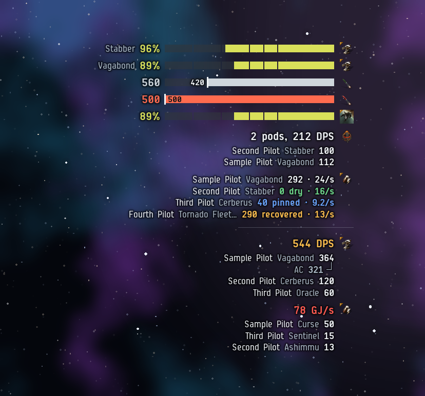

# EVE Pressure Overlay

A Windows overlay for turret, missile and drone hit quality, capacitor warfare and incoming DPS. It reads the English combat logs EVE Online writes locally and draws with [Pillow](https://python-pillow.org/). Linking a character through ESI is optional; it scales the warnings to your ship and hides the overlay while you're docked.

## Run it

1. Use EVE in **Windowed** or **Fixed Window** mode, with English combat logging enabled. If the hit quality stays blank while firing turrets or missiles, check that combat messages include the weapon and hit quality in **Log and Messages**.
2. Download **[EVE-Pressure.zip](https://github.com/aminomancer/eve-pressure-overlay/releases/latest/download/EVE-Pressure.zip)** from the [latest release](https://github.com/aminomancer/eve-pressure-overlay/releases/latest), right-click it, choose **Properties** and tick **Unblock**, then extract it wherever you want to keep it. Double-click **EVE Pressure.cmd** to start the overlay. The first start adds **EVE Pressure** to the Start menu, so you can start it from there afterwards. You can also add a desktop shortcut in **Settings**. Everything the overlay needs is inside the folder, so nothing gets installed. To remove it, delete the folder and its Start menu entry. If you move the folder, start it once from **EVE Pressure.cmd** and the shortcuts follow.
3. The overlay lives in the notification area and shows itself over the focused EVE window, so you can start it before EVE. It hides when you switch away, on the character select screen and, with ESI linked, while docked.
4. Click or right-click the tray icon for **Move overlay**, **Settings…** and **Quit**. In Move mode the overlay gets a dark panel you can drag and shows every meter at once, so you can see its full size. Any meter without recent live data, the kind that would show while locked, shows made-up data instead, including one neut target in each drain state. Choose **Move overlay** again, or press **Ctrl+Alt+F10** (**Ctrl+Shift+F10** if that's taken), to lock it. A locked overlay passes clicks through to EVE except over the row icons, which show tooltips when you hover them. In Move mode a ⚙ button at the bottom opens **Settings**; right-click it for the tray menu, so you can lock the overlay or quit without leaving the game.
5. In **Settings**, choose a character or a different log folder. The default is `Documents\EVE\logs\Gamelogs`, using your Windows Documents location. **Follow active EVE character** uses the pilot in the focused game window's title when available and falls back to the newest session otherwise. **Meters fill from the right** puts the icons on the right and fills bars leftward, for an overlay on the right side of the screen. Turn off **Dark backdrop in Move mode** to see the overlay in Move mode as it looks when locked; you can then drag it only by its drawn bars, text and icons.

Hover the tray icon to see what the overlay is doing, such as a missing log folder or an ESI problem.

To watch the meters change without a fight, tick **Settings → Simulate a fight for testing**. The overlay then writes a two-minute fight on a loop into its own log in `%LOCALAPPDATA%\EVE Pressure\simulation` and follows only that, with every meter and each neut state, and it stays up while you're docked. Untick it, or quit, to go back to your real logs; the setting isn't saved, so the overlay always starts on them.

For per-pilot breakdowns, enable **Pilot Name** and **Ship Type** under **Ships** in EVE's Overview Settings. This setting controls the in-space bracket label that EVE also writes to combat logs. With both, a pilot who reships into an escape-bay frigate or a capsule counts as a new target. If EVE only logs the ship type, events with the same label are grouped together.

## Read the meters

A row only shows while it has something to say. Hit quality rows disappear two minutes after your last shot and reset when you dock. Each row's icon is the item involved, such as your turret, missile or drone, or the top attacker's weapon or neutralizer. Icons come from CCP's image server, and neut and nos cycle times from ESI's public item data; both are cached in `%LOCALAPPDATA%\EVE Pressure\icons`. Text uses EVE's own font, Eve Sans Neue, read from your EVE install in `C:\CCP\EVE` or Steam's `Eve Online` folder. Without it the overlay falls back to Segoe UI.

| Meter | What it shows |
| --- | --- |
| Turret hit quality | Your average damage over the last ten turret results on a target, as a percentage of a normal hit. 100% is roughly what perfect tracking averages. Each grade counts as the middle of its damage band: Grazes 56%, Glances Off 69%, Hits 88%, Penetrates 113%, Smashes 137%. Misses count as 0% and Wrecks as 300%, so ten Wrecks in a row would read 300%. The bar runs to 150%, with ticks at the band edges (50%, 62.5%, 75%, 100%, 125%). It's red below Grazes, then orange, amber and yellow, and green from Penetrates up. |
| Missile hit quality | Your latest volley as a line on a bar that runs up to the best volley with the same missile on the same pilot and ship. The number beside the line is the latest volley and the number at the end is the best. The bar takes the missile's damage type color: blue EM, red thermal, grey kinetic, orange explosive. Missiles have no random roll, so the best volley is full application on that target. The reference restarts after five minutes without hitting that target, on a new ship and on docking. Grouped launchers log one combined line, so a launcher that burns out or reloads out of step lowers the reading, as does a Reactive Armor Hardener adapting. Missiles that never reach the target, from running out of flight time, the target warping or dying, or defender missiles and smartbombs, log nothing. So when a volley is more than twice your usual gap between volleys late (at least five seconds), the row dims and its tooltip says how long it's been. That looks the same whether you stopped firing or your missiles stopped arriving. |
| Drone hit quality | The turret bar for up to your last 50 drone results on the drones' current target, counting every drone type you have out. The icon is the type doing the most damage and the tooltip lists them all. All drones log hit grades, including Hammerheads, Vespas and the EC-600, SW-600 and EV-600 hybrids. It shows while your drones do at least **Settings → Minimum drone DPS**, averaged from their first hit in the last 60 seconds. |
| Breacher pods | How many targets your pods are still ticking on, their combined DPS, and each target's damage per second. Pods log a tick every second, so a target drops off three seconds after its last tick. |
| Outgoing neuts | Each target you neut or nos: the GJ your latest pulse took, then your combined GJ/s on them. The pulse matters most in a fight and the GJ/s shows what a neut-heavy fit adds up to. Each pulse is compared with that module's last full pulse on the target. A pulse of nothing turns the row green with **dry**, for as long as pulses keep coming back empty. A small pulse turns it blue with **pinned**: at most a fifth of a full pulse, or under half once the target is already dry or pinned. A drop to somewhere in between is usually falloff or a resist change and doesn't change the state. A pulse of at least three quarters after dry or pinned turns it amber with **recovered**, so they have cap again and need neuting hard; it goes back to white with the first full pulse at least one and a half cycles later, so it shows for about two cycles however many neuts you stagger. Neuts of the same name count as one module, and pulses of at least three quarters become the new full pulse, so falloff and resist changes can move it. A nosferatu result is ignored while a neut has hit the same target in the last 30 seconds, because most nos take nothing once the target's cap is below yours. The state disappears once none of your modules has pulsed on the target for two of its cycles, for example when they burn out or you leave range. Targets are remembered for five minutes, so a target that regenerates while you're away shows as recovered on your next pulse. These rules build on [ImpactBar](https://github.com/Fatal1ty/ImpactBar)'s. |
| Incoming DPS | DPS and the three biggest sources, with drone damage credited to the pilot who owns the drones. The top source gets a line with their weapon family and its DPS without drones: Pulse, Beam, Blaster, Rail, AC, Arty, Disintegrator, Vorton, Rockets, LM, HAM, HM, Cruise, Torps or Pods. Smartbombs and bombs are left off that line. |
| Incoming neut pressure | GJ/s taken by neutralizers and nosferatus, and the three biggest sources. |

Rows run in that order. A thin line separates what you're doing (the first five) from what's being done to you (the last two). If you split your guns or launchers onto two targets, or fire two kinds of missile, the turret or missile meter shows twice, one per weapon and target, for as long as both keep firing. A target you switched away from doesn't get a second meter, and there are never more than two. When the two meters are on different targets, each gets the target's ship type in grey on the far side of its value, or the pilot's name if both fly the same ship. Pilot rows show the pilot's name then their ship type in grey; when space runs short the ship type is shortened first, since the pilot's name is what gets called. The log never names turret ammo, so two ammo types in the same guns on one target share a meter. Pod and neut targets are listed with the one you started on most recently at the top, so rows don't swap places as numbers change. A target drops off three seconds after its last pod tick, or a minute after your last neut on it; coming back to it later counts as starting again. Hovering a turret, missile or drone icon also shows that weapon's DPS over the last minute, averaged from its first shot.

Each source's rate is averaged from its first pulse or volley, not over the whole window, so a fresh neut reads as one cycle's worth instead of being spread over a minute. A source with one pulse counts as one 12-second neut cycle or a 5-second weapon cycle. Rates age out over 60 seconds for neuts and 15 seconds for damage.

The totals turn amber, then red, at levels that scale with your ship class, which needs ESI. A frigate goes amber at 100 DPS or 5 GJ/s, a cruiser at 300 DPS or 20 GJ/s, a battleship at 700 DPS or 50 GJ/s and a capital at 3,000 DPS or 150 GJ/s. Without ESI the cruiser levels apply.

The log names the turret for incoming turret damage, such as `Mega Pulse Laser II`, and the missile for incoming missile damage, such as `Caldari Navy Scourge Heavy Missile`. It never names turret ammo, so the overlay can't tell a turret's damage type. The missile family doesn't settle range either: heavy missiles come from both cruiser launchers and battleship rapid heavy launchers.

The neut meters use the actual GJ removed in each neutralizer event. Activity ages out even if the log is idle. See [CCP's neutralizer logging notes](https://www.eveonline.com/news/view/patch-notes-version-21-02#modules).

Position, character, drone, layout, ESI and lock settings are saved in `%LOCALAPPDATA%\EVE Pressure\settings.json`.

## Link a character (optional ESI)

Everything works without this. Linking a character lets the overlay ask [ESI](https://developers.eveonline.com/), CCP's official API, where that pilot is and which ship they're flying. It requests only those two permissions and uses them for three things:

- **Warning colors that fit your ship.** The amber and red levels for incoming DPS and neut pressure scale with your ship class (see [Read the meters](#read-the-meters)). Without ESI every ship gets the cruiser levels, so a frigate is warned late and a battleship early.
- **Hiding as soon as you dock.** The game logs don't record docking at citadels. Without ESI the overlay still goes blank in a station, but only once its rows time out, up to two minutes after your last shot.
- **Fresh hit meters.** Docking or changing ships resets the hit quality meters, so the last ship's results don't show after you undock in another.

ESI updates every few seconds, so the overlay reacts a moment after you dock or reship. It checks location and ship about every 5 seconds, only for the character it's following, fetches ship type and group names once per ship, and backs off when ESI asks it to. Hover the tray icon to see whether ESI is complaining.

Open **Settings**, click **Link character…** and log in with EVE in the browser that opens. Repeat for each character. If linking fails, check that no other program is using port 8765.

Refresh tokens are encrypted for your Windows account in `%LOCALAPPDATA%\EVE Pressure\esi.dat`. Unlink a character in **Settings**, or revoke access at [community.eveonline.com/support/third-party-applications](https://community.eveonline.com/support/third-party-applications/).

## AI use

EVE Pressure was built with the help of an AI coding assistant (Anthropic's Claude). It wasn't vibe-coded: I designed how every meter behaves, steered the implementation, and tested it in real fights. I'm mentioning it so you know how it was made.

## Development

Run from source with [Python](https://www.python.org/downloads/windows/) 3.11 or later, including Tcl/Tk. Install Pillow once with `python -m pip install pillow`, then double-click **[Start Overlay.pyw](Start%20Overlay.pyw)** or run `python -m pressure_overlay`. The first start adds a Start menu shortcut pointing at your Python and this folder, the same as the zip does. Add `--preview` to show the overlay without a focused EVE window.

To watch a past fight again, run [`replay.py`](replay.py) as `python replay.py "Pilot Name"`. It finds your most recent combat with that pilot in your game logs, takes in everything fought alongside it (each combat line within a minute of the previous one), and replays it in real time on a loop through the overlay's simulation mode. Without a name it replays your most recent fight. Any part of a log line works as the name, such as a ship type. Add `--preview` to watch it without EVE focused, and quit from the tray icon.

[`python tools/screenshot.py`](tools/screenshot.py) regenerates the screenshot at the top of this page from Move mode's sample data.

[`python build.py`](build.py) builds the portable zip into `dist`. It bundles Python's embeddable runtime for the Python version you build with, plus Tcl/Tk from your install, and Pillow.

To use your own ESI app, register one at [developers.eveonline.com](https://developers.eveonline.com/). Give it the scopes `esi-location.read_location.v1` and `esi-location.read_ship_type.v1` and the callback URL `http://localhost:8765/callback`. Then set `esi_client_id` in `%LOCALAPPDATA%\EVE Pressure\settings.json`.

Run the tests with `python -m unittest discover -s tests`.
Run [Ruff](https://docs.astral.sh/ruff/) with `ruff check .` for linting and `ruff format .` for formatting. Without a global install, use the `ruff.exe` bundled in the [VS Code Ruff extension](https://marketplace.visualstudio.com/items?itemName=charliermarsh.ruff) under `%USERPROFILE%\.vscode\extensions\charliermarsh.ruff-*\bundled\libs\bin`.

